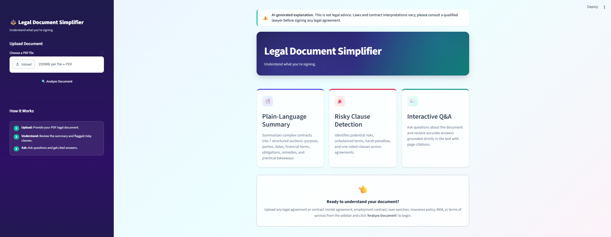
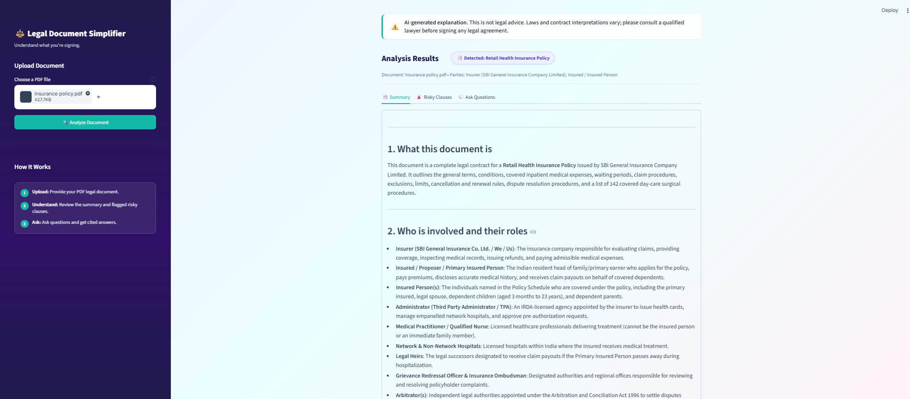
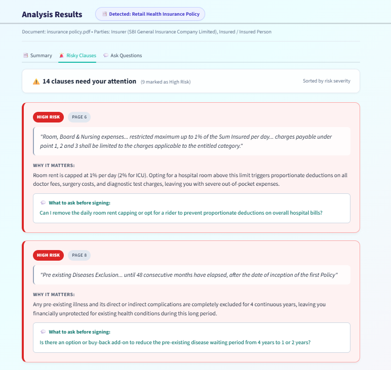
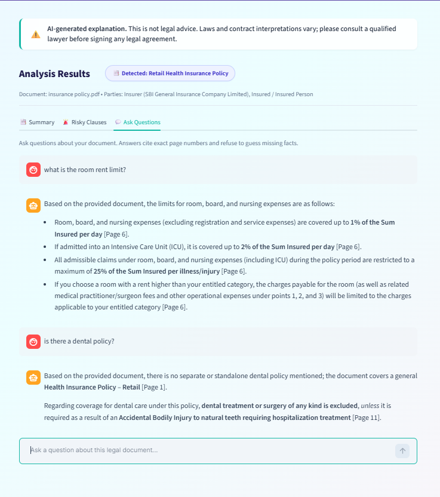
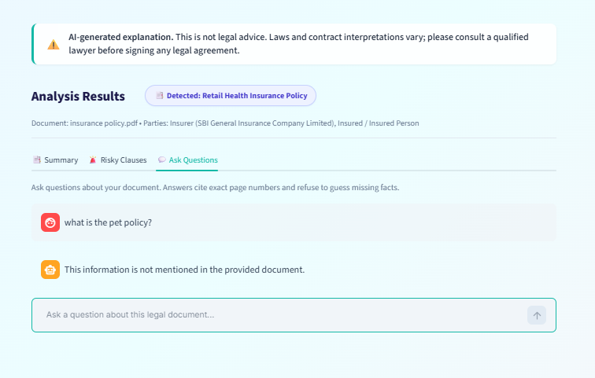

# Legal Document Simplifier

> **Understand what you're signing.**

An intelligent AI assistant designed to simplify complex legal documents (rental agreements, insurance policies, employment contracts, loan agreements, NDAs, and terms of service) into plain, everyday English.



---

## Why Legal Document Simplifier?

Most people sign legal agreements—leases, insurance policies, employment contracts, software terms—without reading or fully understanding them. Legal jargon is intentionally dense, critical obligations are buried across dozens of pages, and one-sided clauses are easy to miss. Professional legal review is prohibitively expensive for routine decisions, leaving individuals vulnerable to unfair terms, hidden fees, and unexpected liabilities.

**Legal Document Simplifier** bridges this gap: it ingests complex legal documents, analyzes their structure and risks, and presents them in accessible, structured English while allowing users to ask questions grounded strictly in the document text.

---

## Key Features

- **Document Type & Party Detection**: Automatically analyzes opening pages to determine the document type, legal category (e.g., rental/lease, insurance policy, employment, NDA), and identified parties.
- **7-Pillar Plain-Language Summary**: Distills contracts into seven clear, standardized pillars:
  1. What this document is
  2. Who is involved and their roles
  3. Key dates and deadlines
  4. Money involved (fees, deposits, penalties)
  5. What each party must do
  6. What happens if something goes wrong (breach, termination)
  7. Bottom line in 2–3 plain sentences
- **Risky Clause Detection**: Evaluates clauses against specialized category risk checklists to flag one-sided or unfavorable terms with severity ratings (High, Medium, Low), plain explanations of why each clause matters, and specific questions to ask before signing.
- **Interactive Grounded Q&A**: Conversational question-answering strictly anchored in document text, citing verified page numbers (e.g., `[Page 4]`, `[Pages 6, 7]`). If an answer is not present in the document, the assistant explicitly states that it is not mentioned rather than hallucinating.
- **Multi-Stage Local Caching**: Caches classification, summaries, risk assessments, and FAISS vector indices on disk (`.cache/`) for instant re-loads with zero API calls.
- **Robust Rate-Limiting & Model Fallback**: Proactive batching with retry-delay backoff for embedding quotas, plus automatic fallback across Gemini model tiers.

---

## Screenshots

### 1. Plain-Language Summary


### 2. Risky Clause Detection


### 3. Interactive Q&A with Page Citations


### 4. Grounded Refusal for Out-of-Scope Questions


---

## How It Works

```
                               ┌────────────────────────────────────────┐
                               │              Uploaded PDF              │
                               └──────────────────┬─────────────────────┘
                                                  │
                                       (pdfplumber extraction)
                                                  │
                                                  ▼
                               ┌────────────────────────────────────────┐
                               │      Page Documents with Metadata      │
                               └──────┬──────────────────────────┬──────┘
                                      │                          │
                 (Opening pages classification)                  │
                                      ▼                          │
                   ┌──────────────────────────────────────┐      │
                   │ Doc Type, Category & Identified      │      │
                   │               Parties                │      │
                   └──────────────────┬───────────────────┘      │
                                      │                          │
                                      ▼                          ▼
                   ┌──────────────────────────────────────┐   ┌─────────────────────────────────────┐
                   │  Summary & Risky Clause Analysis     │   │     Recursive Character Chunking    │
                   │  (Standard pass or Group & Merge)    │   │      (chunk_size=1500, overlap=200) │
                   └──────────────────────────────────────┘   └──────────────────┬──────────────────┘
                                                                                 │
                                                                       (gemini-embedding-2)
                                                                                 │
                                                                                 ▼
                                                              ┌─────────────────────────────────────┐
                                                              │          FAISS Vector Store         │
                                                              │       (Top-4 Semantic Retrieval)    │
                                                              └──────────────────┬──────────────────┘
                                                                                 │
                                                                                 ▼
                                                              ┌─────────────────────────────────────┐
                                                              │      Grounded Answer Generation     │
                                                              │  • [Page N] Normalized Citations    │
                                                              │  • Refusal if not in document       │
                                                              └─────────────────────────────────────┘
```

1. **PDF Text Extraction**: Uses `pdfplumber` to extract layout-aware text from each page, wrapping text into LangChain `Document` objects with 1-based page metadata (`metadata={"page": n}`). Scanned documents with non-selectable text are flagged immediately.
2. **Type Detection**: Inspects the opening pages using Gemini to determine the document type, category, and contracting parties.
3. **Summary & Risk Analysis**:
   - **Standard Documents (`len(full_text) <= MAX_DIRECT_CHARS`, i.e., <= 60,000 characters)**: Analyzed in a single structured pass using category-specific prompt guidelines.
   - **Long Documents (`len(full_text) > MAX_DIRECT_CHARS`, i.e., > 60,000 characters)**: `_split_into_page_groups` splits pages into sequential groups where each group's combined `page_content` fits within `MAX_DIRECT_CHARS` (60,000 characters). Each group is summarized sequentially and synthesized via `MERGE_SUMMARIES_PROMPT` into a cohesive 7-pillar summary. Risk clauses are scanned across each page group, deduplicated, and sorted by severity (`High`, `Medium`, `Low`).
4. **Interactive Retrieval-Augmented Generation (RAG)**:
   - **Chunking**: Text is split into semantically coherent passages using `RecursiveCharacterTextSplitter` with configurable sizing (`chunk_size=1500`, `chunk_overlap=200`), preserving page metadata.
   - **Embeddings**: Chunks are embedded using `gemini-embedding-2` in controlled batches.
   - **Indexing**: Embeddings are stored in a `FAISS` index (`faiss-cpu`) that is held in memory and also saved to `.cache/` for reuse.
   - **Retrieval & Citations**: For each user query, the retriever fetches the top 4 most relevant chunks. The response generator synthesizes the answer, strictly normalizing citations to `[Page N]` format.
   - **Strict Grounding**: If the requested fact is missing from the document, the model explicitly responds: *"This information is not mentioned in the document."*

---

## Reliability Engineering

- **Model Fallback**: The app calls `invoke_with_model_fallback`. Transient `503` / `UNAVAILABLE` errors are retried on the current model up to 3 attempts (with 2s and 4s backoff). Model fallback is triggered only by quota/rate-limit errors (`is_quota_error`: matching `429`, `RESOURCE_EXHAUSTED`, `quota`, or `resourcelimitexceeded`), which automatically switch from the primary model (`gemini-3.6-flash`) to `gemini-3.5-flash-lite` (and raise `ModelQuotaExhaustedError` if all models in `MODEL_FALLBACK_LIST` are exhausted).
- **Batched Embeddings with Retry-Delay Backoff**: Free-tier Gemini embedding APIs enforce a 100 requests/minute quota. The vector store generator batches chunk embeddings (~30 chunks per batch) with small pauses. If a 429 error occurs, it parses the API's recommended `retryDelay` (defaulting to 30s) and retries up to 3 times while updating the user interface.
- **Per-Stage Local Caching**: Analysis stages (classification, 7-pillar summary, risky clauses, and FAISS vector indices) are saved to disk under `.cache/` using SHA-256 document content hashes. Re-analyzing the same file executes with zero API calls.
- **Clean Session State Management**: Uploading or switching files instantly clears all previous analysis state (summaries, risk clauses, vector store, and chat history) before processing, preventing cross-document contamination or stale UI renders.

---

## Tech Stack

- **Frontend**: [Streamlit](https://streamlit.io/) with custom styling (`styles.css`)
- **LLM Orchestration**: [LangChain](https://www.langchain.com/) (`langchain`, `langchain-core`, `langchain-community`, `langchain-google-genai`)
- **AI Models**: Google Gemini (`gemini-3.6-flash`, `gemini-3.5-flash-lite`, `gemini-embedding-2`)
- **Vector Search**: [FAISS](https://github.com/facebookresearch/faiss) (`faiss-cpu`)
- **Document Processing**: `pdfplumber`
- **Environment Management**: `python-dotenv`

---

## Project Structure

```text
├── app.py                  # Main Streamlit web application
├── styles.css              # Custom styling and design tokens
├── requirements.txt        # Python package dependencies
├── README.md               # Project documentation
├── .env.example            # Environment variable template
├── .streamlit/             # Streamlit configuration settings
├── src/                    # Backend modules
│   ├── analyzer.py         # Classification, summarization, and risk scanner
│   ├── cache.py            # Local disk caching for JSON stages and FAISS indices
│   ├── chunker.py          # Document text chunking with metadata preservation
│   ├── config.py           # Configuration constants and model fallback logic
│   ├── pdf_reader.py       # PDF text extraction via pdfplumber
│   ├── prompts.py          # Prompt templates and category risk checklists
│   ├── rag_chain.py        # FAISS retrieval and QA chain with citation normalization
│   └── vector_store.py     # FAISS vector store creation with batching & backoff
├── tests/                  # Test suite and utilities
│   ├── __init__.py         # Package marker
│   ├── check_setup.py      # Environment and API key verification script
│   ├── list_models.py      # Available Gemini models inspection script
│   ├── test_rag.py         # End-to-end command-line RAG pipeline test
│   └── verify_chat_test.py # AppTest verification for chat order and layout
├── screenshots/            # UI screenshots for documentation
└── data/                   # Sample documents
    └── sample_docs/        # Sample PDFs for testing
```

---

## Tested On

- **Residential Rental Agreement**: 4-page standard residential lease agreement (security deposits, maintenance obligations, termination clauses, inspection rights).
- **Retail Health Insurance Policy**: ~27-page comprehensive policy document (pre-existing condition waiting periods, room rent caps, specific illness exclusions, claim procedures).
- *All testing performed in English.*

---

## Limitations

- **English Only**: The application prompts, risk checklists, and citation normalizers are designed and validated exclusively for English-language documents.
- **Text-Based Digital PDFs Only**: Requires PDFs with selectable text. Scanned or image-only documents without selectable text will be rejected with an alert.
- **AI Judgement, Not Legal Advice**: Risk ratings, explanations, and summaries are generated by machine learning models and represent automated textual assessments. They should always be reviewed by a human and do not constitute formal legal advice or create an attorney-client relationship.

---

## Privacy & Data Handling

- **Gemini API Data Handling**: Document text is sent to Google's Gemini API for analysis. How Google handles API data depends on the plan and its current terms, and on free tiers submitted content may be used to improve Google's products. Avoid uploading sensitive personal documents.
- **In-Session Processing**: Uploaded documents are read and analyzed within your active Streamlit runtime session.
- **Local Disk Cache**: Analysis artifacts and search indices are stored locally in the `.cache/` directory on your machine. No documents are stored in external databases or shared with third parties beyond the standard Google Gemini API inference requests. Users can purge stored analyses at any time by deleting the `.cache/` folder.
- **No User Accounts or Tracking**: The application requires no logins, accounts, or persistent cloud database connections.

---

## Getting Started

### 1. Prerequisites

- Python 3.10+
- Google Gemini API Key ([Google AI Studio](https://aistudio.google.com/))

> **Notes on Models, Quotas & Caching**: Model names are set in `src/config.py` and may need updating if Google retires them; the free tier's limits are low (the free tier allows about 20 requests per day per model), and re-analyzing the same file is served from the local cache.

### 2. Installation

```bash
git clone https://github.com/Soundarya-Rao/Legal-Document-Simplifier.git
cd Legal-Document-Simplifier

python -m venv venv

# On Windows:
.\venv\Scripts\activate
# On Linux/macOS:
source venv/bin/activate

pip install -r requirements.txt
```

### 3. Configure API Key

Copy the example environment file and add your Google Gemini API key:

```bash
cp .env.example .env
```

Edit `.env`:
```env
GEMINI_API_KEY=your_key_here
```

### 4. Run the Application

```bash
streamlit run app.py
```

Open `http://localhost:8501` in your browser.

---

## Running Tests

- **Chat & UI Order Verification (Offline, 0 API calls)**:
  ```bash
  python tests/verify_chat_test.py
  ```
- **Gemini Environment Verification**:
  ```bash
  python tests/check_setup.py
  ```
- **End-to-End RAG Pipeline Test**:
  > **Note**: `tests/test_rag.py` executes real Google Gemini API calls (document summarization, risk scanning, embeddings, and Q&A) and consumes free-tier API quota.
  ```bash
  python tests/test_rag.py
  ```

---

## Future Work

- **Regional Language Support**: Multilingual summarization and cross-lingual question-answering.
- **Optical Character Recognition (OCR)**: Ingestion pipeline for scanned physical contracts and image-based PDFs using OCR engines.
- **User Accounts & Saved Workspaces**: Secure user sessions allowing users to organize contracts and track agreement lifecycles.
- **Standardized Evaluation Benchmark**: Curated evaluation dataset with ground-truth risk classifications to systematically benchmark and measure prompt accuracy.
